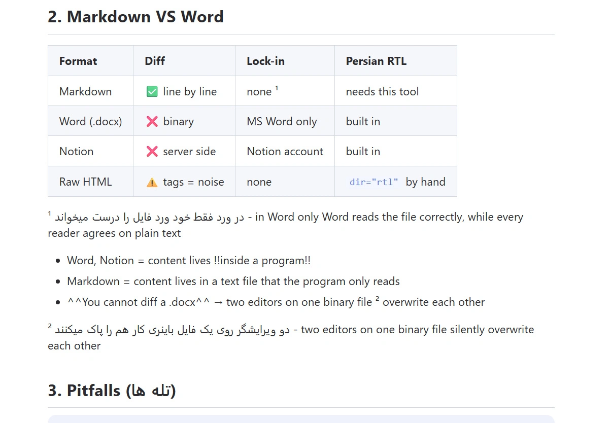
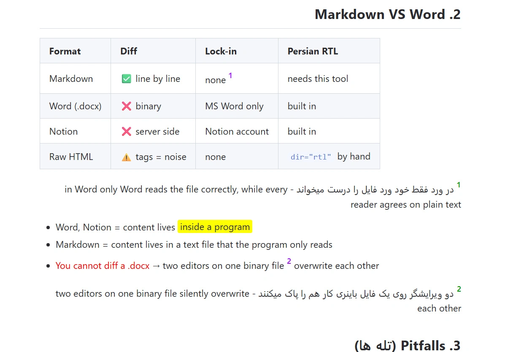
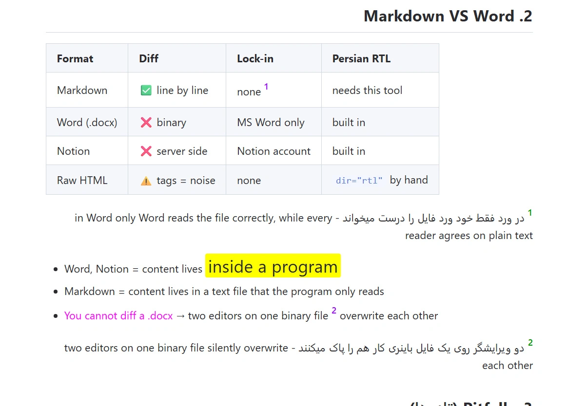
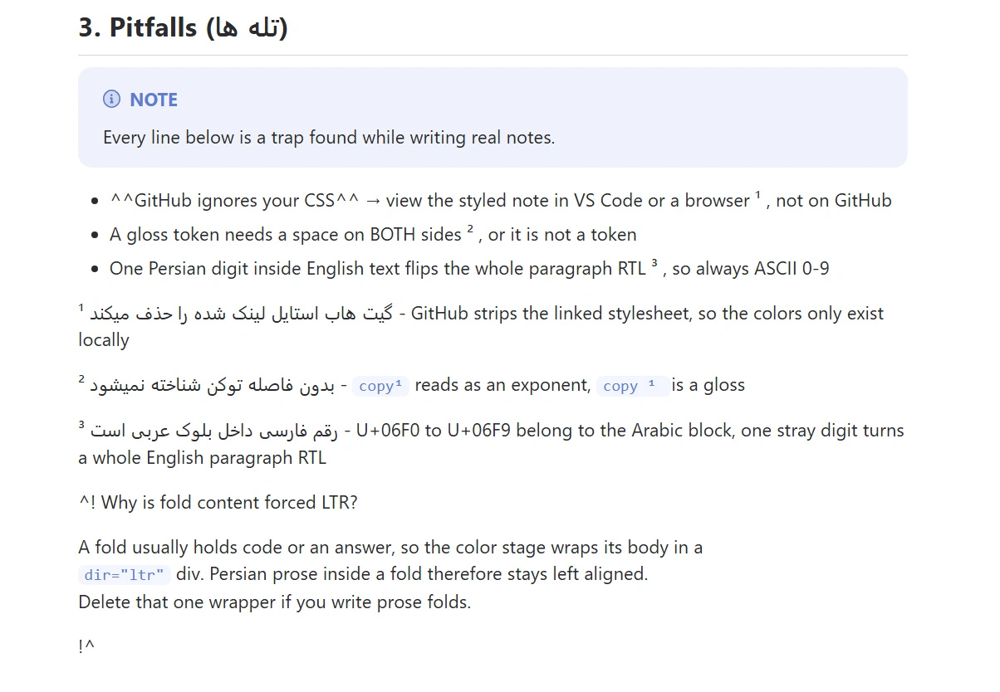
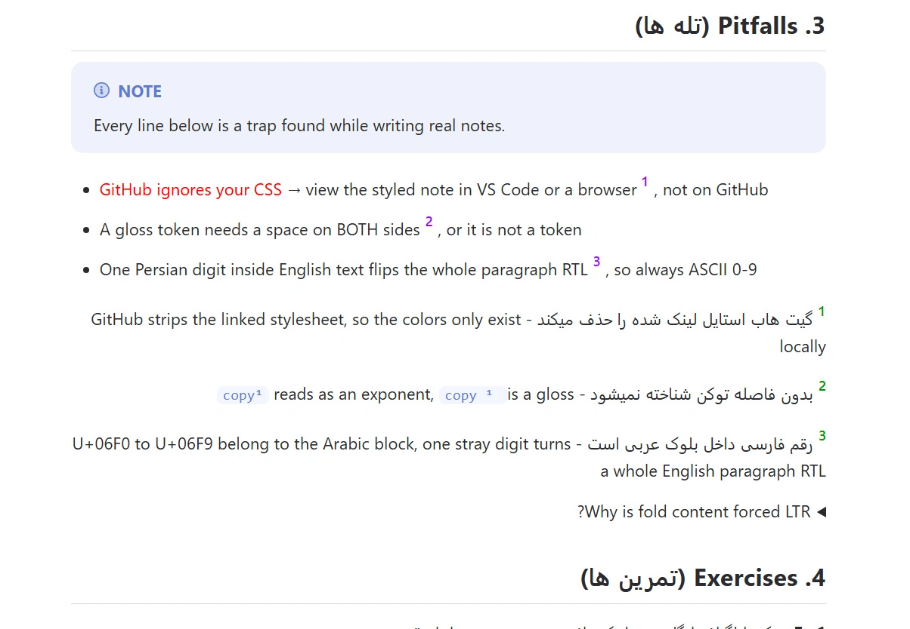

<div dir="rtl">

# md-note-toolkit

</div>

<div dir="rtl">

[English](README.md) | **فارسی**

</div>

<div dir="rtl">

پیش‌پرداز یادداشت مارکدون که **فایل خام را تمیز نگه می‌دارد** و در عوض یک
یادداشت رندرشده‌ی راست‌چین، رنگی و دوزبانه تحویل می‌دهد.

</div>

<div dir="rtl">

چهار چیزی را اضافه می‌کند که مارکدون برایش سینتکس ندارد - جهت متن در سطح
بلوک، تاکید رنگی، بخش تاشو، واژه‌نامه‌ی زبان دوم - و می‌تواند نتیجه را
**برگرداند** به مارکدون تمیز.

</div>

<div dir="rtl">

بدون نصب. فقط کتابخانه‌ی استاندارد پایتون.

</div>

---

<div dir="rtl">

## مسئله

</div>

<div dir="rtl">

مارکدون به‌طور بومی این‌ها را ندارد:

</div>

<div dir="rtl">

| کمبود                | راه‌حل رایج               | هزینه                                 |
| -------------------- | ------------------------- | ------------------------------------- |
| جهت متن در سطح بلوک  | `<div dir="rtl">` دستی    | فایل خام ناخوانا می‌شود               |
| تاکید رنگی           | `<span style="...">`      | استایل درون‌خطی، غیرقابل نگهداری      |
| بخش تاشو             | `<details>` + `<summary>` | ۵ خط به‌جای ۲ خط                      |
| واژه‌نامه‌ی زبان دوم | ترجمه‌ی درون‌خطی          | چیدمان می‌شکند، توکن‌ها منفجر می‌شوند |

</div>

<div dir="rtl">

نویسنده‌های فارسی، عربی و عبری و هرکس **یادداشت دوزبانه** می‌نویسد مدام به
هر چهار مورد می‌خورد. راه‌حل معمول - نوشتن HTML خام داخل مارکدون - فایل را
سخت‌خوان می‌کند، diff را خراب می‌کند و برای ویرایش توسط AI شکننده است.

</div>

<div dir="rtl">

این ابزار منبع را به‌صورت مارکدون ساده با چند مارکر کوچک نگه می‌دارد و HTML
را موقع پردازش می‌سازد.

</div>

<div dir="rtl">

> **مشخصات محصول است؛ اسکریپت‌ها کامپایلرند.** کیفیت یادداشت از قانون‌های
> سبک در [`docs/MY_STYLE.md`](docs/MY_STYLE.md) می‌آید، نه از کد. کد فقط
> اعمال آن قانون‌ها را ارزان می‌کند. چون این قانون‌ها یک فایل متنی ساده‌اند،
> می‌توانید به هر AI بدهیدشان و برای زبان خودتان بازنویسی کنید.

</div>

---

<div dir="rtl">

## چرا مارکدون و نه PDF یا WORD

</div>

<div dir="rtl">

- **متن ساده یعنی diff و grep و کنترل نسخه.** پی‌دی‌اف و ورد باینری‌اند:
  نمی‌شود دید چه عوض شده، نمی‌شود merge کرد، نمی‌شود دقیق جست‌وجو کرد. با یک
  واژگان ثابت برای بخش‌ها (`Pitfalls`, `Cheat Sheet`, `Equivalents`, ...) یک
  `grep` آن بخش را در _همه‌ی_ یادداشت‌ها با _هر_ موضوعی پیدا می‌کند.
- **سازگار با AI.** مدل‌ها مارکدون را بومی می‌خوانند و می‌نویسند. ورد و
  پی‌دی‌اف در هر دو جهت نیاز به تبدیل دارند - توکن اضافه به‌علاوه‌ی ساختار
  ازدست‌رفته، و معمولاً جدول‌ها و جهت متن در این تبدیل خراب می‌شوند.
- **بدون قفل شدن به یک فروشنده.** در VS Code، گیت‌هاب، Obsidian و هر
  مرورگری رندر می‌شود. چند ده کیلوبایت به‌جای مگابایت.
- **بدون وابستگی.** این ابزار هیچ چیز بیرون از کتابخانه‌ی استاندارد را
  import نمی‌کند (`tkinter`, `re`, `ctypes`, `pathlib`, `argparse`). نه
  `pip install`، نه محیط مجازی - پوشه را کپی کن و اجرا کن.

</div>

<div dir="rtl">

مارکدون برای چیدمان دقیق چاپی، انتشارات سنگین ریاضی و همکارهای غیرفنی که
انتظار WORD دارند انتخاب **بدتری** است.

</div>

---

<div dir="rtl">

## چرا توکن ذخیره می‌کند

</div>

<div dir="rtl">

نکته زیباتر شدن یادداشت نیست. نکته این است که یک AI می‌تواند یادداشت باکیفیت
را با کسری از هزینه تولید کند، چون مارکدون تمیز می‌نویسد - و بعداً همان را
دوباره می‌خواند - نه HTML.

</div>

<div dir="rtl">

**اندازه‌گیری‌شده** روی [`examples/before.md`](examples/before.md)، یک
یادداشت نمونه‌ی کامل با فهرست، متن دارای هر دو مارکر تاکید، یک جدول، هفت
توکن واژه‌نامه و سه بلوک تاشو:

</div>

<div dir="rtl">

|                                                      | کاراکتر | خط  |
| ---------------------------------------------------- | ------- | --- |
| مارکرهای خام - چیزی که AI می‌نویسد و دوباره می‌خواند | 3086    | 87  |
| خروجی رندرشده - چیزی که نمایش‌دهنده نشان می‌دهد      | 4229    | 170 |

</div>

<div dir="rtl">

منبع **۱۱۴۳ کاراکتر (۲۷ درصد) کوچک‌تر** از محصول نهایی است، حدود ۲۸۵
توکن. این هزینه یک‌بار موقع تولید پرداخت می‌شود و بعد در هر بار خواندن
دوباره‌ی یادداشت.

</div>

<div dir="rtl">

با [`examples/measure.py`](examples/measure.py) بازتولیدش کنید؛ همان اسکریپت
چک می‌کند که فایل کامیت‌شده واقعاً خروجی ابزار است و اینکه `reverse` منبع را
برمی‌گرداند.

</div>

<div dir="rtl">

چهار مکانیزم، به ترتیب اثر واقعی:

</div>

<div dir="rtl">

1. **خواندن دوباره‌ی ارزان - بزرگ‌ترین برد.** صرفه‌جویی تولید یک‌بار اتفاق
   می‌افتد؛ صرفه‌جویی خواندن دوباره در هر جلسه. اگر HTML رندرشده را منبع
   حقیقت نگه دارید، هر گفت‌وگوی بعدی دوباره پول آن HTML را می‌دهد.
   `reverse` شما را به مارکدون تمیز برمی‌گرداند، پس هیچ‌وقت مجبور نیستید.
2. **ویرایش امن.** diff تمیز مارکدون یعنی می‌شود یک بخش را جدا فرستاد و جدا
   ویرایش کرد. با HTML دستی، یک AI ممکن است فقط یک `</div>` را بیندازد و -
   چون تودرتویی با شمارنده دنبال می‌شود - **بقیه‌ی فایل بی‌سروصدا دیگر
   راست‌چین نمی‌شود.** این واقعاً اتفاق افتاده: ۱۳ تگ `<div dir="ltr">`
   بسته‌نشده، و یک بخش کامل تمرین‌ها پردازش‌نشده بیرون آمد. پاس اختیاری
   بستن خودکار به‌جای ترمیز بی‌صدا، یک جفت تگ _خالی و قابل grep_ تولید
   می‌کند تا خسارت دیده شود: `<div[^>]*>\s*\n</div>` را جست‌وجو کنید.
3. **واژه‌نامه به‌جای ترجمه.** یک مارکر `¹` به‌علاوه‌ی یک توضیح دوکلمه‌ای
   چند توکن هزینه دارد. ترجمه‌ی کامل درون‌خطی پنج تا ده برابر آن هزینه دارد
   و چیدمان را خراب می‌کند - و توضیح کوتاه همزمان تمرین واژگان هم هست.
4. **مارکر کوتاه به‌جای HTML.** `^!` / `!^` به‌جای
   `<details>` + `<summary>`؛ `^^x^^` به‌جای `<span class="r">x</span>`.

</div>

---

<div dir="rtl">

## نیازمندی‌ها

</div>

<div dir="rtl">

- **پایتون ۳.۱۰ یا جدیدتر.** کد از annotation اتحادی `Path | None` و
  generic مثل `list[str]` استفاده می‌کند که به ۳.۱۰ نیاز دارد. روی ۳.۱۴
  تست شده. چیز دیگری لازم نیست.
- هر سیستم‌عاملی. موقع جایگزینی فایل اصلی، ویندوز نسخه‌ی قدیمی را به سطل
  بازیافت می‌فرستد؛ لینوکس و مک آن را به `<name>.bak` تغییر نام می‌دهند
  (یکتا، هرگز بازنویسی نمی‌شود) و به‌صورت هشدار گزارش می‌کنند. هیچ‌چیز هرگز
  پاک نمی‌شود.

</div>

---

<div dir="rtl">

## شروع سریع

</div>

<div dir="rtl">

CLI بدون پنجره - ورودی اصلی:

</div>

```bash
python md_batch.py forward "notes.md"          # apply color markers, then RTL
python md_batch.py reverse "notes.md"          # back to clean Markdown
python md_batch.py forward "a.md" "b.md"       # several files in one run
python md_batch.py color "notes.md" --new      # write notes.out.md, keep input
```

<div dir="rtl">

حالت‌ها: `reverse`, `color`, `rtl`, `forward` (= color و بعد RTL). پیش‌فرض
`forward` است. کد خروج: `0` موفق، `1` یک یا چند فایل ناموفق، `2` آرگومان
نامعتبر.

</div>

<div dir="rtl">

رابط گرافیکی - دابل‌کلیک یا اجرای مستقیم:

</div>

```bash
python md_batch_gui.py           # multi-file window over the same engine
python md_color_gui.py           # single file: markers -> HTML
python md_rtl_advance_gui.py     # single file: RTL wrapping
python md_reverse_gui.py         # single file: HTML -> markers
```

<div dir="rtl">

استفاده‌ی برنامه‌ای:

</div>

```python
import md_batch
results = md_batch.run_batch(["a.md", "b.md"], mode="forward")
for r in results:
    print(r.source, r.status, r.warnings)
```

<div dir="rtl">

`run_batch` برای هر فایل یک رکورد برمی‌گرداند با `source`, `destination`,
`status` (`saved` / `unchanged` / `error`), `warnings` و `error`. خطای یک فایل
هرگز بقیه را متوقف نمی‌کند.

</div>

<div dir="rtl">

تست‌ها:

</div>

```bash
python test_md_batch.py
```

---

<div dir="rtl">

## مرجع سینتکس

</div>

<div dir="rtl">

این‌ها را در فایل خام مارکدون بنویسید. هرگز HTML را دستی ننویسید - ابزار
تولیدش می‌کند و `reverse` دوباره پاکش می‌کند.

</div>

<div dir="rtl">

| مارکر         | تبدیل می‌شود به     | کاربرد                         |
| ------------- | ------------------- | ------------------------------ |
| `^^text^^`    | span قرمز           | هشدار، خطا، تفاوت              |
| `!!text!!`    | span هایلایت        | واژه‌ی کلیدی، تعریف            |
| `^!` ... `!^` | بلوک تاشو           | جواب تمرین، عمق اختیاری        |
| `¹ word`      | توکن رنگی واژه‌نامه | ترجمه‌ی کوتاه یک عبارت سخت     |
| ` ``` `       | دست‌نخورده          | کد حصاردار هرگز پردازش نمی‌شود |

</div>

<div dir="rtl">

قانون‌های مارکرها:

</div>

<div dir="rtl">

- `^^` و `!!` روی یک خط می‌مانند، هرگز تودرتو نمی‌شوند و هرگز در عنوان یا
  کد نمی‌آیند. سقف ۲ تا ۳ در هر ~۲۰ خط، وگرنه بی‌معنی می‌شوند.
- `^!` و `!^` هر کدام **تنها روی خط خودشان**. یک عنوان کوتاه اختیاری بعد از
  `^!` همان summary بلوک تاشو می‌شود. همه‌چیز داخل بلوک خام می‌ماند، دقیقاً
  مثل کد حصاردار.
- توکن واژه‌نامه **به یک فاصله قبل و بعد** نیاز دارد (`copy ¹ , no waiting`).
  همان فاصله‌ها مرز توکن‌اند. خط تعریف با توکن در ستون صفر و یک فاصله بعد از
  آن شروع می‌شود و در پاراگراف خودش، دقیقاً زیر همان جدول یا بلوکی که توضیح
  می‌دهد می‌آید - هرگز وسط جمله.
- تعداد فرد `^^` یا `!!` در یک خط دست‌نخورده می‌ماند و به‌صورت هشدار گزارش
  می‌شود، هرگز بی‌صدا حدس زده نمی‌شود.

</div>

<div dir="rtl">

گرامر کامل، HTML دقیقی که هر مارکر تولید می‌کند و قرارداد رفت‌وبرگشت در
[`docs/SPEC.md`](docs/SPEC.md) هست.

</div>

---

<div dir="rtl">

## مثال

</div>

<div dir="rtl">

پوشه‌ی `examples/` یک یادداشت کامل را در هر دو شکل نگه می‌دارد تا قبل از
اجرا روی فایل‌های خودتان دقیقاً ببینید خط تولید چه می‌کند.

</div>

<div dir="rtl">

| فایل                                | چیست                                              |
| ----------------------------------- | ------------------------------------------------- |
| [`before.md`](examples/before.md)   | مارکرهای خام - چیزی که شما یا AI می‌نویسد         |
| [`after.md`](examples/after.md)     | خروجی رندرشده - محصولی که نمایش‌دهنده نشان می‌دهد |
| [`measure.py`](examples/measure.py) | عددهای بالا را بازتولید و رفت‌وبرگشت را چک می‌کند |

</div>

<div dir="rtl">

`after.md` تولیدی است، هرگز دستی ویرایش نمی‌شود. بازسازی:

</div>

```
cp examples/before.md examples/after.md
python md_batch.py forward examples/after.md
```

<div dir="rtl">

بعد `href` استایلشیت را `../md.css` بگذارید. ابزار مسیر مطلق `md.css` کنار
`md_color_gui.py` را می‌نویسد که روی ماشین شما درست است و برای بقیه‌ی
خواننده‌های ریپو بی‌فایده.

</div>

<div dir="rtl">

### چه شکلی می‌شود

</div>

<div dir="rtl">

گیت‌هاب استایلشیت لینک‌شده را حذف می‌کند، پس یادداشت استایل‌دار فقط در VS
Code یا مرورگر دیده می‌شود. این‌ها رندر محلی دو بخش از `examples/after.md`
اند، کنار منبع خامی که از آن ساخته شده‌اند.

</div>

<div dir="rtl">

**بخش ۲ - مارکرهای خام، بعد یادداشت تولیدشده**

</div>

<div dir="rtl">

| قبل                                                                                      | بعد                                                                               |
| ---------------------------------------------------------------------------------------- | --------------------------------------------------------------------------------- |
|  |  |

</div>

<div dir="rtl">

**همان بخش بعد از تغییر دستی دو کلاس CSS**

</div>



<div dir="rtl">

در فایل تولیدشده دقیقاً دو کلمه ویرایش شد: `class="hy"` شد
`class="hy s26"`، و `class="r"` شد `class="m"`. هیچ چیز دیگری تکان نخورد.
این کلاس‌ها در [`md.css`](md.css) زندگی می‌کنند - `.r` قرمز، `.m` سرخابی،
`.hy` هایلایت زرد، `.s22` / `.s26` اندازه‌ی قلم - پس تغییر استایل برای هر
span یک کلمه است، یا اگر ترجیح می‌دهید اصلاً به یادداشت دست نزنید، یک خط در
استایلشیت. دلیل اینکه ابزار نام کلاس تولید می‌کند و هرگز `style=""`
درون‌خطی نمی‌نویسد همین است: فایل رندرشده بعد از تولید هم قابل ویرایش
می‌ماند.

</div>

<div dir="rtl">

**بخش ۳ - مارکرهای خام، بعد یادداشت تولیدشده**

</div>

<div dir="rtl">

| قبل                                                                                      | بعد                                                                               |
| ---------------------------------------------------------------------------------------- | --------------------------------------------------------------------------------- |
|  |  |

</div>

---

<div dir="rtl">

## تنظیمات

</div>

<div dir="rtl">

هر پیچ تنظیم، یک ثابت بالای ماژول خودش است - نه فایل کانفیگی برای پیدا کردن،
نه حالت پنهان. پنجره‌های گرافیکی هم از همان ثابت‌ها پر می‌شوند.

</div>

<div dir="rtl">

| ثابت                                      | ماژول                                        | معنا                                          |
| ----------------------------------------- | -------------------------------------------- | --------------------------------------------- |
| `CSS_HREF`                                | `md_color_gui.py`                            | استایلشیتی که به خروجی لینک می‌شود            |
| `FOOT_ENABLED`, `FOOT_OPEN`               | `md_color_gui.py`                            | مدیریت توکن واژه‌نامه                         |
| `OUT_SUFFIX`, `REPLACE_ORIGINAL`          | `md_color_gui.py`, `md_rtl_advance_gui.py`   | نام‌گذاری خروجی                               |
| `SMART_RTL`                               | `md_rtl_advance_gui.py`                      | فقط بلوک‌های دارای خط راست‌چین بسته‌بندی شوند |
| `RTL_RE`                                  | `md_rtl_advance_gui.py`                      | کدام کاراکترها راست‌به‌چپ حساب می‌شوند        |
| `HEADING_LEVELS`                          | `md_rtl_advance_gui.py`, `md_reverse_gui.py` | `"2-6"`, `"1,3-4"`؛ پیشوند `^` برعکس می‌کند   |
| `AUTOCLOSE_HTML`, `HANDLE_HTML`           | `md_rtl_advance_gui.py`                      | مدیریت تگ بسته‌نشده                           |
| `FOLD_OPEN`, `FOLD_CLOSE`, `HEAD_PATTERN` | `md_rtl_advance_gui.py`                      | سینتکس مارکر، خط head                         |
| `RULES`, `REMOVE_RTL`, `REMOVE_LINK`      | `md_reverse_gui.py`                          | دامنه‌ی تبدیل معکوس                           |

</div>

<div dir="rtl">

مقدار خالی همیشه یعنی آن قابلیت خاموش است.

</div>

<div dir="rtl">

**درباره‌ی `CSS_HREF`:** مقدار داخل یادداشت به شکل
`<link rel="stylesheet" href="...">` نوشته می‌شود. یادداشت‌ها معمولاً در
پوشه‌ای غیر از پوشه‌ی این ابزار زندگی می‌کنند، پس **باید یک مسیر کامل** باشد
(یا یک URL با `file://`) - href نسبی به‌محض باز شدن یادداشت از جای دیگر
می‌شکند. مقدار پیش‌فرض `md.css` کنار اسکریپت را پیدا می‌کند، پس یک clone
تازه بدون هیچ ویرایشی کار می‌کند. برای تغییر یک‌باره‌ی همه‌ی استایل‌ها
نشانی‌اش را به استایلشیت خودتان بدهید.

</div>

---

<div dir="rtl">

## خط تولید

</div>

```
raw notes (markers)  --color-->  HTML spans + details  --rtl-->  styled RTL note
        ^                                                              |
        +------------------------- reverse ----------------------------+
```

<div dir="rtl">

`forward` اول color و بعد RTL را اجرا می‌کند. `reverse` برعکسش را اجرا
می‌کند و منبع تمیز مارکرها را برمی‌گرداند. رفت‌وبرگشت از نظر محتوا یکسان است
و همین باعث می‌شود نگه داشتن فایل خام به‌عنوان تنها منبع حقیقت امن باشد.

</div>

<div dir="rtl">

جایگزینی مخرب نیست: فایل اصلی به سطل بازیافت می‌رود و فایل‌های بدون تغییر
اصلاً لمس نمی‌شوند، پس مهر زمانشان سر جایش می‌ماند.

</div>

---

<div dir="rtl">

## این ابزار به درد چه کسی نمی‌خورد

</div>

<div dir="rtl">

اگر فقط در گیت‌هاب منتشر می‌کنید، احتمالاً به این ابزار نیاز ندارید -
گیت‌هاب خودش `<div dir="rtl">` و `<details>` و callout نوع `[!NOTE]` را
رندر می‌کند.

</div>

<div dir="rtl">

این ابزار وقتی به‌صرفه است که **هر روز یادداشت می‌نویسید** و می‌خواهید فایل
خام خوانا، قابل diff و برای ویرایش AI ارزان باشد، در حالی که سبک بصری خودتان
را هم در VS Code یا مرورگر داشته باشید.

</div>

---

<div dir="rtl">

## شخصی‌سازی مشخصات سبک

</div>

<div dir="rtl">

[`docs/MY_STYLE.md`](docs/MY_STYLE.md) یک نمونه‌ی کامل از یک سبک یادداشت است:
سیاست زبانی، واژگان بخش‌ها، سقف تاکید، قانون جدول‌ها، جای واژه‌نامه،
تمرین‌ها. این فایل **نیاز** ابزار نیست.

</div>

<div dir="rtl">

گرامری که روی آن سوار است - هر مارکر چه معنایی دارد، چه HTML بیرون می‌آید،
چه چیزی را هرگز نباید دستی نوشت - جدا در [`docs/SPEC.md`](docs/SPEC.md)
مشخص شده. آن فایل زبان‌ناشناس است و همان چیزی است که وقتی یادداشت مطابق سبک
خودتان می‌خواهید به AI می‌دهید.

</div>

<div dir="rtl">

گردش کار در نظر گرفته‌شده این است که کپی‌اش کنید و با هر AI بازنویسی‌اش
کنید: زوج زبانی را عوض کنید، نام بخش‌ها را عوض کنید، عوض کنید چه چیزی
تاکید بگیرد. اسکریپت‌ها کاری ندارند قانون‌های شما چه می‌گوید - فقط سینتکس
مارکرها را اعمال می‌کنند.

</div>

---

<div dir="rtl">

## چیدمان پروژه

</div>

```
md_batch.py            headless CLI and batch engine (main entry point)
md_batch_gui.py        Tkinter window over the same engine
md_color_gui.py        markers -> HTML spans, details, gloss colors
md_rtl_advance_gui.py  RTL wrapping, smart mode, unclosed-tag detection
md_reverse_gui.py      HTML -> markers, removes RTL wrappers and link line
md.css                 default stylesheet
docs/SPEC.md           marker grammar, generated HTML, round-trip contract
docs/MY_STYLE.md       one complete example style preset
examples/before.md     sample note as raw markers
examples/after.md      the same note after color + RTL
examples/measure.py    reproduces the token numbers and checks the round trip
examples/img/            screenshots of the rendered example
md_batch_ai.md         compact CLI/API reference written for AI agents
test_md_batch.py       unittest suite, no external fixtures
```

---

<div dir="rtl">

## محدودیت‌های شناخته‌شده

</div>

<div dir="rtl">

- بیرون از ویندوز سطل بازیافت وجود ندارد، پس هر جایگزینی یک پشتیبان به جا
  می‌گذارد: `notes.md.bak` و بعد `notes.md.bak.2` و همین‌طور. پشتیبان‌ها
  هرگز بازنویسی نمی‌شوند، یعنی اجرای مکرر فایل جمع می‌کند - هر وقت لازم
  نداشتید پاکشان کنید. `*.bak` در gitignore است.
- `SMART_RTL` با `RTL_RE` تصمیم می‌گیرد چه چیزی بسته‌بندی شود که به‌طور
  پیش‌فرض عبری، عربی (پس فارسی و اردو هم داخلش)، بلوک‌های تکمیلی و توسعه‌ی
  عربی و هر دو بلوک فرم ارائه‌ی عربی را پوشش می‌دهد. برای هر خط راست‌به‌چپ
  دیگر همان یک الگو را ویرایش کنید. خط‌های چپ‌به‌راست باید **بیرون** آن
  بمانند - اضافه کردن CJK یا لاتین باعث می‌شود متن چپ‌به‌راست داخل div
  راست‌چین برود و چیدمان بشکند. توجه کنید بلوک عربی رقم‌های فارسی
  `U+06F0-U+06F9` را هم شامل می‌شود، پس یک رقم فارسی سرگردان داخل یک
  پاراگراف انگلیسی کل آن بلوک را راست‌چین می‌کند؛ قانون سبک دقیقاً به همین
  دلیل رقم فارسی را ممنوع کرده است.
- محتوای داخل بلوک تاشوی `^!` خام می‌ماند، پس متن راست‌به‌چپ آنجا توسط پاس
  RTL راست‌چین نمی‌شود. بلوک تولیدشده همچنین به فرض اینکه محتوای تاشده کد
  است آن را چپ‌به‌راست می‌کند؛ اگر به‌جایش متن می‌پیچید، آن یک div را در
  `md_color_gui.py` (به‌همراه تگ بسته‌اش) حذف کنید - بخش ۵
  [`docs/SPEC.md`](docs/SPEC.md).
- summary پیش‌فرض یک بلوک تاشوی بدون عنوان فارسی است (`DEFAULT_SUMMARY`).
  در `md_color_gui.py` و `md_reverse_gui.py` با هم عوضش کنید.
- ابزار عمداً مارکرمحور است، نه یک پارسر عمومی مارکدون. فهرست تودرتو داخل
  بلوک تاشو یا عنوان setext را نمی‌فهمد.
- `reverse` ممکن است خط خالی بعد از پایان یک بلوک تاشو را از دست بدهد، پس
  `!^` در فایل خام به بلوک بعدی می‌چسبد. مارکرها هنوز کار می‌کنند: پاس RTL
  فاصله‌ی بین بلوک‌ها را به دقیقاً یک خط خالی نرمال می‌کند، که برای
  `reverse` خط خالی اضافه‌ای باقی نمی‌گذارد. `examples/measure.py` این را به
  شکل هشدار گزارش می‌کند و پنهانش نمی‌کند.
- اسکن تگ بسته‌نشده کد حصاردار را رد می‌کند ولی کد درون‌خطی را نه. یک
  `<div>` که داخل backtick در متن عادی نوشته شده باشد یک تگ باز واقعی حساب
  می‌شود، پس اجرا هشدار می‌دهد و یک جفت تگ خالی و قابل grep تولید می‌کند.
  بدون علامت `<` بنویسیدش.

</div>

---

<div dir="rtl">

## نقشه‌ی راه

</div>

<div dir="rtl">

قدم‌های بعدی، به ترتیب:

</div>

<div dir="rtl">

- [x] `examples/` - نمونه‌ی قبل/بعد به‌همراه اسکریپت اندازه‌گیری پشت عددهای
      توکن بالا
- [x] اسکرین‌شات رندرشده‌ی `examples/after.md` زیر بخش مثال
- [x] `RTL_RE` - تشخیص راست‌به‌چپ حالا یک تنظیم مستند بالای فایل است و از
      فقط عربی به عبری به‌علاوه‌ی همه‌ی بلوک‌های عربی گسترش یافته
- [x] جایگزین غیر ویندوزی برای جایگزینی فایل اصلی - نسخه‌ی قدیمی به
      `<name>.bak` یکتا تبدیل می‌شود و اجرا آن را هشدار می‌دهد
- [x] `docs/SPEC.md` - گرامر مارکرها، جدا از هر سبک شخصی
- [x] ارائه‌ی `rules.md` به‌عنوان یک preset نمونه زیر `docs/` - حالا
      `docs/MY_STYLE.md`
- [ ] چیدمان `pytest` و CI روی ویندوز به‌علاوه‌ی اوبونتو

</div>

---

<div dir="rtl">

## مجوز

</div>

<div dir="rtl">

MIT - [`LICENSE`](LICENSE) را ببینید.

</div>
